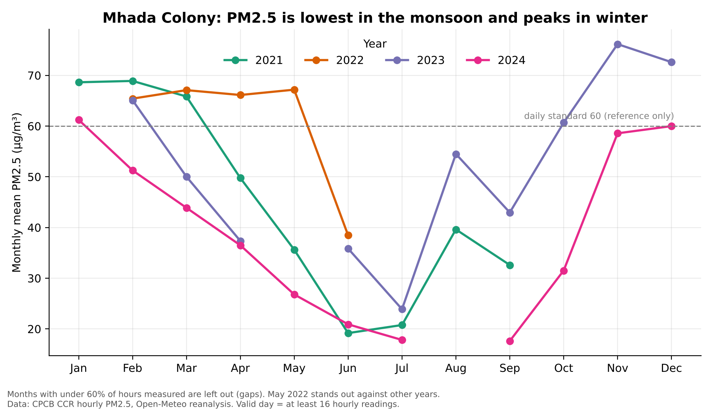
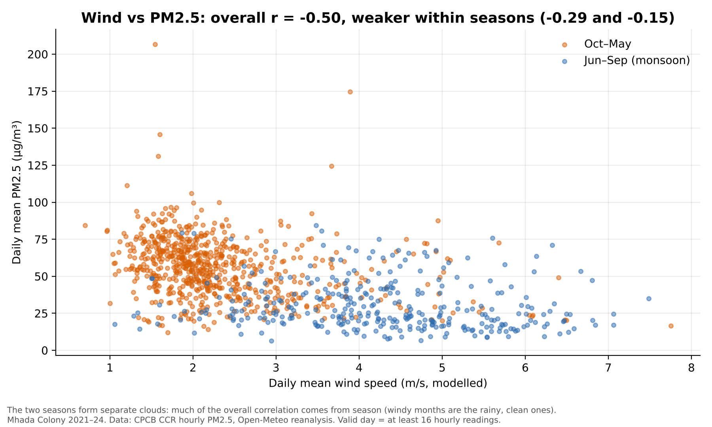
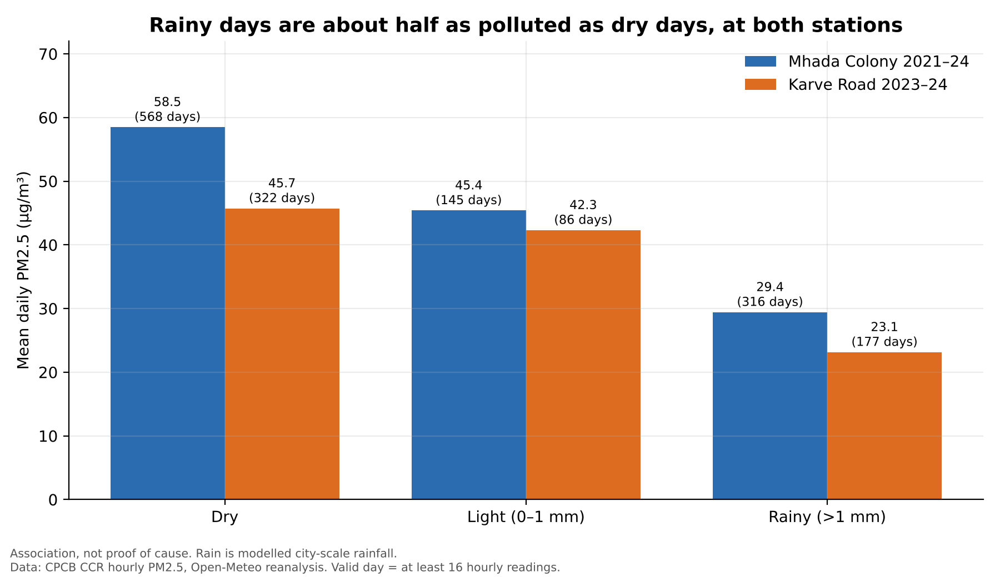
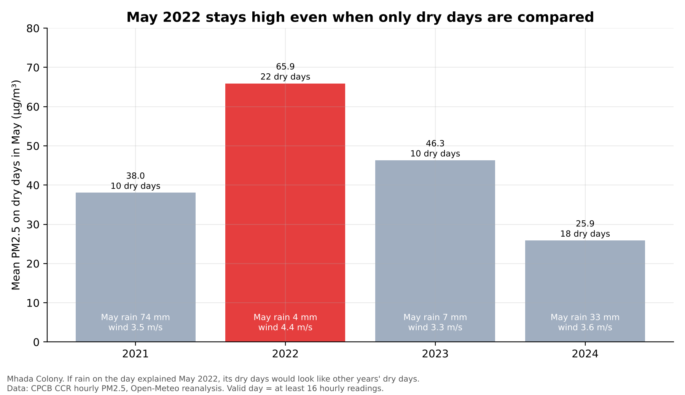
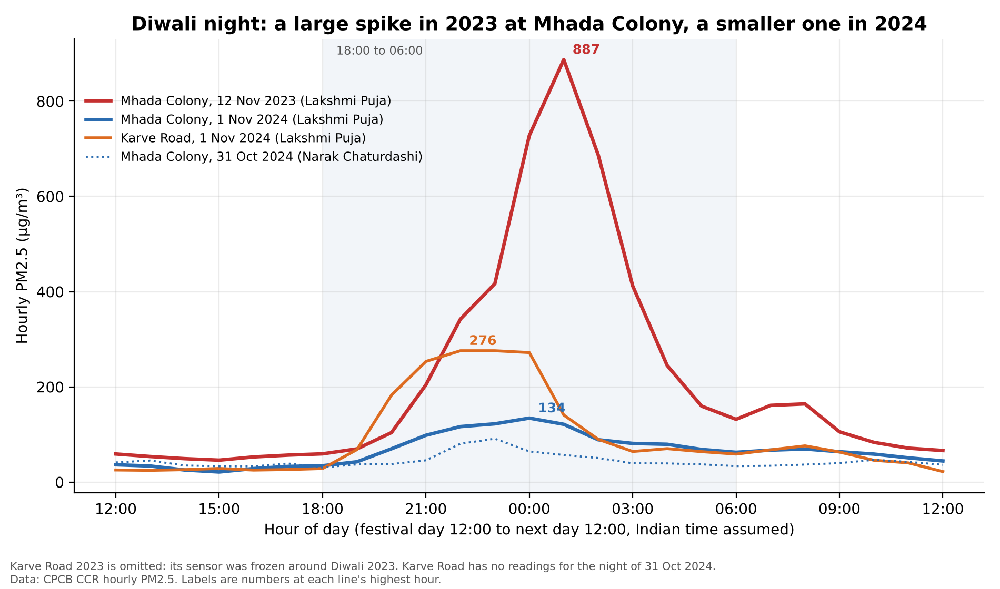

# Pune Air Quality: PM2.5, Rain and Wind (2021–2024)

A PostgreSQL analysis of how daily PM2.5 in Pune relates to rain and wind, built from public monitoring data and a public weather reanalysis. The project is as much about handling messy real data honestly as it is about the result.

> **Short answer:** rainy days were consistently cleaner than dry days at two stations, while wind showed almost no effect once season was accounted for. One station and modelled weather mean this is suggestive evidence, not proof of cause.

## Research question

How does PM2.5 in Pune vary across months and seasons, and do rain and wind help explain it?

Starting hypothesis: more rain or wind means lower PM2.5. Results below.

## Data

| Source                                                          | What                                                         | Notes                                                           |
| --------------------------------------------------------------- | ------------------------------------------------------------ | --------------------------------------------------------------- |
| CPCB CCR data repository (Maharashtra → Pune → station → 1H) | Hourly station CSVs, PM2.5 in µg/m³                        | One file per station and year                                   |
| Open-Meteo Historical Weather API (ERA5 reanalysis)             | Hourly rain, wind speed and direction, temperature, humidity | Modelled grid data (~9–25 km), identical for all Pune stations |

Raw files are not included in this repository. Check each source's terms before reusing the data (Open-Meteo's free tier is for non-commercial use).

Stations loaded:

| Station             | Years             | Hourly rows | PM2.5 readings |
| ------------------- | ----------------- | ----------- | -------------- |
| Mhada Colony (IITM) | 2021–2024        | 35,064      | 24,845         |
| Karve Road (MPCB)   | 2023–2024        | 17,544      | 14,325         |
| Hadapsar (IITM)     | 2024 (from 1 May) | 5,880       | 2,632          |

MIT Kothrud 2024 was downloaded and discarded: the file contains no PM2.5 values.

## Database design

```sql
CREATE TABLE pollution_dataset (
    station TEXT,
    recording_time TIMESTAMP,
    pm25_ugm3 NUMERIC,
    pm10_ugm3 NUMERIC,
    wind_speed_ms NUMERIC,
    wind_direction_deg NUMERIC,
    humidity_pct NUMERIC,
    PRIMARY KEY (station, recording_time)
);

CREATE TABLE weather_data (
    location TEXT,
    time TIMESTAMP,
    rain_mm NUMERIC,
    wind_speed_10m_ms NUMERIC,
    wind_direction_10m_deg NUMERIC,
    temperature_2m_c NUMERIC,
    humidity_2m_pct NUMERIC,
    PRIMARY KEY (location, time)
);
```

A small reference table holds the days of each Diwali chain (dates taken from published calendars; where calendars disagree, the `notes` column says so):

```sql
CREATE TABLE festival_dates (
    festival      TEXT,
    festival_date DATE,
    day_label     TEXT,
    notes         TEXT,
    PRIMARY KEY (festival, festival_date)
);
```

Design choices:

- One table with a `station` column instead of one table per station. Stations are never averaged together blindly.
- Each CSV is loaded into a staging table that mirrors the file (`raw_karve_road_2024`, `raw_weather`), then copied with `INSERT ... SELECT`, adding the station or location name.
- Row counts and PM2.5 counts are checked against the source file after every load.

Load notes:

- Mhada Colony 2021 and 2022 files write missing values as the text `NA`; set the importer's NULL string to `NA`.
- The Open-Meteo CSV has a 3-line info block above the header; remove it before importing.
- Import with pgAdmin (psql's `\copy` does not work from VS Code extensions).

## Method

1. **Coverage rule.** A month is only comparable if at least 60% of its hours have a PM2.5 reading.
2. **Valid day.** A day counts only if it has at least 16 hourly readings (the minimum CPCB uses for daily figures).
3. **Daily join.** Daily PM2.5 and daily weather are joined on date:

```sql
WITH daily_pm25 AS (
    SELECT recording_time::date AS date,
           ROUND(AVG(pm25_ugm3), 2) AS avg_pm25,
           COUNT(pm25_ugm3) AS pm25_hours
    FROM pollution_dataset
    WHERE station = 'mhada_colony'
    GROUP BY recording_time::date
    HAVING COUNT(pm25_ugm3) >= 16
), daily_weather AS (
    SELECT time::date AS date,
           ROUND(AVG(wind_speed_10m_ms), 2) AS avg_wind_speed,
           SUM(rain_mm) AS total_rain
    FROM weather_data
    WHERE location = 'pune'
    GROUP BY time::date
), joined AS (
    SELECT p.date, p.avg_pm25, p.pm25_hours, w.avg_wind_speed, w.total_rain
    FROM daily_pm25 p
    INNER JOIN daily_weather w ON p.date = w.date
)
SELECT
    CASE WHEN total_rain = 0 THEN 'DRY'
         WHEN total_rain > 1 THEN 'RAINY'
         ELSE 'LIGHT' END AS rain_group,
    COUNT(*) AS days,
    ROUND(AVG(avg_pm25), 1) AS mean_pm25,
    CORR(avg_pm25, avg_wind_speed) AS corr_wind
FROM joined
GROUP BY 1
ORDER BY 1;
```

4. **Confounding check.** Wind and rain were also compared within each month, because both follow the season.
5. **Replication.** The same analysis was repeated on Karve Road.
6. **Festival check.** Diwali days (2023 and 2024) were joined to hourly PM2.5. A festival day is defined as running from 06:00 to 05:59 the next morning, so a late-night fireworks peak stays with the evening it belongs to:

```sql
SELECT fd.festival_date, fd.day_label,
       ROUND(MAX(p.pm25_ugm3), 1) AS max_pm25,
       ROUND(AVG(p.pm25_ugm3), 1) AS mean_pm25
FROM festival_dates fd
LEFT JOIN pollution_dataset p
  ON fd.festival_date = (p.recording_time - INTERVAL '6 hours')::date
 AND p.station = 'mhada_colony'
GROUP BY fd.festival_date, fd.day_label
ORDER BY fd.festival_date;
```

## Findings

### Seasonal pattern

At Mhada Colony, monthly mean PM2.5 is lowest in the monsoon and highest in winter, and the pattern repeats across years. Months with under 60% of hours measured are left out of the chart.



### Wind

Across all 1,029 valid days at Mhada Colony, wind vs PM2.5 gives r = −0.50. Within individual months it mostly disappeared (monthly r from −0.45 to +0.13), so the overall number largely reflects season: the windy months are also the rainy, clean ones.



### Rain

**Mhada Colony, 2021–2024 (1,029 valid days)**

| Rain group      | Days | Mean PM2.5 (µg/m³) |
| --------------- | ---- | -------------------- |
| Dry             | 568  | 58.5                 |
| Light (0–1 mm) | 145  | 45.4                 |
| Rainy (> 1 mm)  | 316  | 29.4                 |

Within the same month, rainy days were about 13–24 µg/m³ cleaner than dry days in May, June, October and November. January showed no difference (only 7 rainy days).

**Karve Road, 2023–2024 (585 valid days)**

| Rain group | Days | Mean PM2.5 (µg/m³) |
| ---------- | ---- | -------------------- |
| Dry        | 322  | 45.7                 |
| Light      | 86   | 42.3                 |
| Rainy      | 177  | 23.1                 |

Wind within each rain group at Karve Road: r = +0.08, −0.07, −0.23.



### Unexplained: May 2022

Mhada Colony averaged 67.2 µg/m³ in May 2022 versus 35.6 (2021) and 26.8 (2024). It was not driven by extreme or stuck values, and dry days in May 2022 averaged 65.9 versus 25.9–46.3 in other Mays. May 2022 was also the windiest of the four Mays, so neither wind nor same-day rain explains it.



### Temperature and humidity

Across all 1,029 valid days at Mhada Colony, humidity vs PM2.5 gives r = −0.50, while temperature gives r = −0.11. Within individual months humidity stayed negative in most months (for example −0.76 in June and −0.77 in October) but was near zero in January and February, while temperature changed sign from month to month (about +0.5 to +0.6 in March, June and October, but −0.33 in January and −0.59 in December).

Humid days are also the rainy days, so humidity may only stand in for rain. On days with **no rain** (568 days), the humidity correlation falls to 0.01, so humidity has no visible link with PM2.5 once rain is removed. Temperature on dry days gives r = −0.35, but because its sign flips within months this most likely reflects the cool-season versus warm-season difference and not a temperature effect.

Taken together, rain is the only weather factor that held up under these checks; wind, humidity and temperature mostly reflect season or rain.

### Diwali

Hourly PM2.5 at Mhada Colony around Diwali shows a clear evening-to-midnight spike, which also served as a check on the clock used in the PM2.5 files. On the main night of 2023 (12 November), PM2.5 rose from about 70 µg/m³ at 19:00 to 204 at 21:00 and peaked at **887.4 at 01:00 on 13 November**. In 2024 the rise was much smaller and spread over two evenings (peaks of 91.0 at 23:00 on 31 October and 134.3 at 00:00 on 2 November), which fits the Amavasya tithi overlapping both dates.

|      | Ordinary days before (mean) | Lakshmi Puja day (mean) | Ratio                                                 | Peak hour |
| ---- | --------------------------- | ----------------------- | ----------------------------------------------------- | --------- |
| 2023 | 55.5                        | 210.7                   | about 3.8 (about 3.2 using only the dry baseline day) | 887.4     |
| 2024 | 51.8                        | 61.2                    | about 1.2                                             | 134.3     |

Ordinary days are the first three days of each chain (Vasu Baras, Dhanteras, Kali Chaudas). In 2023 two of them were rainy (9.5 mm and 2.5 mm), which made the baseline unusually clean; the 2024 baseline days were almost dry. Wind was similar on baseline and festival days in both years, and both festival nights were calm and dry, so wind and rain do not explain why 2024 was so much smaller. A rough check outside the database suggested that splitting fireworks over two nights would not account for the whole gap either. What did explain the difference is not known from this data.



**Second station (Karve Road).** Karve Road cannot confirm the 2023 result: its PM2.5 sensor was frozen around Diwali 2023 (on several days all 24 hourly values are identical, and the night of 12 November shows 78.7 repeated for about 14 hours instead of a spike). In 2024 there are no readings on 31 October; on 1 November PM2.5 rose from about 28 in the late afternoon to 183 at 20:00 and about 276 at 22:00–23:00 (day peak 275.9, day mean 96.7 against about 35 on the baseline days, a ratio of about 2.7). That is roughly twice Mhada Colony's peak and ratio for the same night, so the size of the 2024 spike differs between stations, and the comparison between 2023 and 2024 rests on one station only. The timing of the Karve spike (evening rise, peak around 22:00–midnight) supports the Indian-time assumption.

## Data quality notes

- Karve Road 2024: about a quarter of PM2.5 readings sit in runs of repeated identical values (the longest is 263 hours), PM10 is almost exactly 2.9× PM2.5 in 96% of hours, and the rainfall column is all zeros. Its wind and humidity sensors read implausibly (July humidity around 7%), so only the Open-Meteo weather is used.
- Raw values are kept; a flag for suspected stuck values is planned but not yet implemented.
- A separate check that dropped 148 suspicious Karve days (repeated-value test) gave the same pattern, but that was run outside the database.
- IITM stations (Hadapsar, Mhada Colony) have no wind or humidity readings of their own.

## Limitations

- Two stations, one city, mostly 2021–2024, with long gaps (for example July–December 2022 is empty at Mhada Colony).
- Weather is modelled at city scale, not measured at each station.
- The PM2.5 files are assumed to use Indian time. The timing of the Diwali spikes (evening rise, peak around midnight) supports this in both 2023 and 2024, but it is an inference, not a documented fact.
- Karve Road has frozen-sensor days around Diwali 2023 and a gap on 31 October 2024, so the festival comparison between years is based on Mhada Colony alone.
- Diwali dates come from published calendars that disagree for 2024 (31 October vs 1 November); the whole chain is stored to avoid choosing a date after seeing the data.
- Observational data: associations here do not establish cause. Rainy days differ from dry days in other ways (cloud, humidity, air origin).
- Thresholds (60% monthly coverage, 16 hours per day, rain groups) are choices; sensitivity to them has only been partly tested.

## Possible next steps

- Implement the stuck-value flag (window functions) and repeat the analysis with and without flagged days.
- Test shifted weather windows to confirm the daily results do not depend on the clock assumption.
- Test other stations or years.
- Extend the festival check to other stations and use a baseline of ordinary days before the chain.

## Author

Sahil Raichurkar
